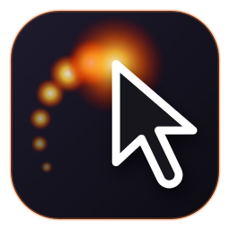
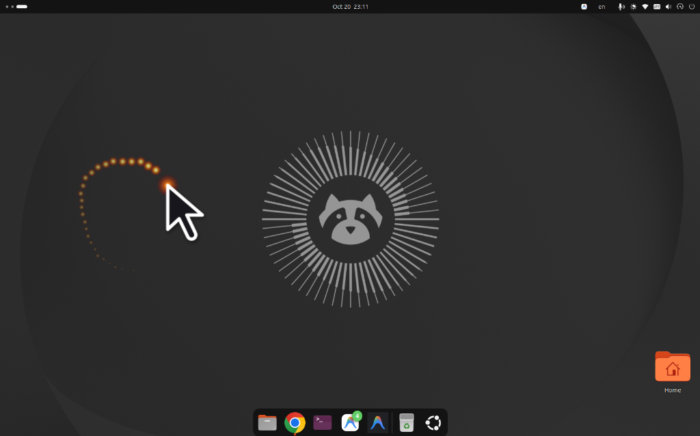

<div align="center">
  
  <h1>Speed Cursor — Dynamic Size, Fire Halo &amp; Comet Trail</h1>
  <p>
    <strong>Never lose your mouse pointer again on large, 4K, or multi-monitor Linux desktops.</strong><br/>
    Smoothly enlarges your cursor with movement velocity, surrounds it with a breathing halo of light, and ignites a directional comet-fire motion trail.
  </p>

  <p>
    <a href="https://extensions.gnome.org/extension/11388/speed-cursor-dynamic-size-fire-halo-comet-trail/">
      
    </a>
    <a href="https://github.com/mgmehdiforme/speed-cursor/releases/latest">
      
    </a>
    <a href="LICENSE">
      
    </a>
  </p>
</div>

---

## 📸 Preview in Action

<div align="center">
  
  <p><em>Enlarged velocity-scaled pointer with the <strong>Fire-Breathing Halo</strong> at the tip and a curved <strong>Comet-Fire Motion Trail</strong> showing the exact path traveled.</em></p>
</div>

---

## ✨ Why Speed Cursor?

Traditional "shake-to-find" utilities only trigger after you violently shake the mouse back and forth. **Speed Cursor** is designed for effortless, continuous spatial awareness:

1. **⚡ Continuous Velocity Scaling (`Speed Size Scaling`)**
   * Smoothly scales your cursor from `1.0x` (stationary) $\rightarrow$ `1.3x` (slow movement) $\rightarrow$ up to `4.0x–8.0x` (fast sweeps).
   * Uses a crisp, high-resolution vector cursor locked to the exact pointer hotspot so the tip never shifts or blurs.
2. **🔥 Fire-Breathing (`Halo of Light`)**
   * Surrounds the cursor tip with a dual-harmonic breathing aura of light so you can spot a parked or moving pointer immediately.
   * Automatically **stokes brighter and wider** when you move the mouse faster, and gently breathes like a warm ember when stationary.
3. **☄️ Comet-Fire (`Directional Motion Trail`)**
   * Leaves a smooth, tapering ribbon of fire behind your moving pointer so your eyes immediately see **where the mouse was** and **which direction it moved**.
   * Built on a zero-GC pre-allocated particle pool with path interpolation and upward thermal drift.
4. **🎯 On-Click Ripple Animation (`Screen Recording Helper`)**
   * Spawns an expanding concentric shockwave ring anchored to the exact screen coordinate `(x, y)` where you click — ideal for screen recordings, video tutorials, and live presentations.
   * Optional **Color-Coding by Mouse Button**: **Left Click** = Amber Gold, **Right Click** = Electric Cyan, **Middle Click** = Neon Emerald (or match your chosen Flame Color Theme).
5. **🎨 5 Built-In Flame Color Themes**
   * Choose between **🔥 Ember Fire**, **☀️ Solar Gold**, **⚡ Blue Plasma**, **🟢 Emerald Wildfire**, and **🌹 Crimson Phoenix** to match any wallpaper or desktop theme.
6. **🎛️ One-Click Quick Settings & Full Libadwaita Preferences**
   * Toggle **Speed Size Scaling**, **Fire-Breathing Halo**, **Comet-Fire Trail**, and **Click Ripple (Screen Recording)** independently right from the top-right GNOME Quick Settings menu, or fine-tune every slider in the native Settings window.
7. **🎬 Fullscreen Video & Game Smart Detection**
   * Automatically pauses effects whenever a video player or game hides the system pointer, and uses **0% CPU** when idle.

---

## 🚀 Easy Installation

### Option 1: Install from GNOME Extensions (1-Click)
Visit the official **[GNOME Extensions Page](https://extensions.gnome.org/extension/11388/speed-cursor-dynamic-size-fire-halo-comet-trail/)** and toggle the switch to **ON**.

### Option 2: Clone & Run the Installer
```bash
git clone https://github.com/mgmehdiforme/speed-cursor.git
cd speed-cursor
./install.sh
```

### Option 3: Install From Release `.zip` Bundle
Download the latest `.zip` from [GitHub Releases](https://github.com/mgmehdiforme/speed-cursor/releases/latest) and run:
```bash
gnome-extensions install --force speed-cursor@local.shell-extension.zip
gnome-extensions enable speed-cursor@local
```

---

## ⚙️ Configuration & Settings

You can customize **Speed Cursor** from three places:

1. **Top-Right GNOME Quick Settings Menu:**
   Click the system status menu in the top-right corner $\rightarrow$ click the arrow (`>`) on **Speed Cursor** to toggle individual effects, pick a size preset, or open **Speed Cursor Settings…**.
2. **Desktop App Launcher:**
   Press the `Super` key and search for **Speed Cursor Settings**.
3. **Terminal:**
   ```bash
   gnome-extensions prefs speed-cursor@local
   ```

| Setting | Key | Default | Description |
| :--- | :--- | :---: | :--- |
| **Speed Size Scaling** | `effect-enabled` | `true` | Enlarge pointer dynamically based on movement speed |
| **Minimum Moving Size** | `min-move-scale` | `1.3` | Scale multiplier as soon as the mouse starts moving |
| **Maximum Fast Size** | `max-fast-scale` | `4.0` | Maximum scale multiplier at high speed (`1.5x–8.0x`) |
| **Fast Speed Threshold** | `max-speed-threshold` | `2600` | Velocity ($\text{px/s}$) required to reach maximum size |
| **Fire-Breathing Halo** | `fire-breathing-enabled` | `true` | Animate a breathing halo of light around the pointer |
| **Always Breathe** | `fire-breathing-always` | `true` | Keep halo gently breathing even when mouse is parked |
| **Halo Diameter** | `fire-breathing-size` | `88` | Diameter of the breathing light aura (`40px–220px`) |
| **Comet-Fire Trail** | `comet-fire-enabled` | `true` | Ignite a directional comet trail on mouse movement |
| **Comet Trail Length** | `comet-fire-length` | `18` | Number of flame particles in the comet tail (`6–28`) |
| **Flame Color Theme** | `fire-theme` | `'ember'` | `ember`, `solar`, `plasma`, `emerald`, or `crimson` |
| **On-Click Ripple** | `click-effect-enabled` | `true` | Expanding click ring for screen recordings & demos |
| **Color-Code by Button** | `click-color-by-button` | `true` | Left=Gold, Right=Cyan, Middle=Emerald |
| **Click Ripple Diameter** | `click-effect-size` | `110` | Maximum diameter of the expanding click ring (`48px–240px`) |
| **Click Ripple Duration** | `click-effect-duration` | `0.38` | Duration of each click shockwave animation (`0.15s–1.0s`) |

---

## 🗑️ Uninstallation

```bash
./uninstall.sh
```

---

## 📄 License

Released under the [MIT License](LICENSE). Created by [Mehdi Golzari](https://github.com/mgmehdiforme).
